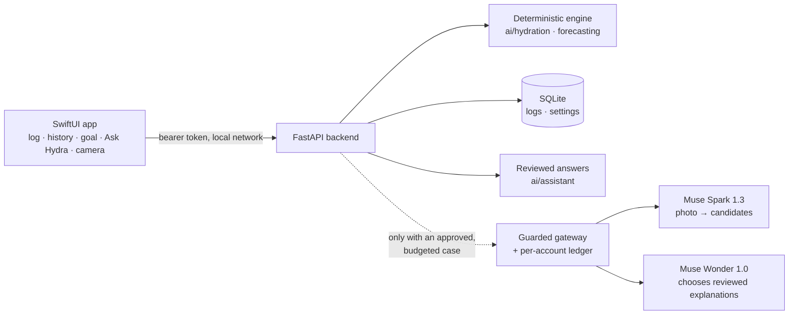

# Hydra AI

Native iPhone wellness prototype for the Meta Global AI Developer Hackathon 2026 **Startup** track. SwiftUI talks to a FastAPI and SQLite backend with deterministic accounting from `ai/hydration`; see the [project status](docs/PROJECT_STATUS.md).

**What works today (mock or local, tested):** confirmed beverage logging with edit and delete, daily totals and an optional goal you set, 7-day history, camera recognition with confirmation, a workout sweat-loss range, the Ask Hydra assistant with reviewed, sourced answers, and Muse Wonder 1.0 hydration intelligence that chooses which reviewed explanations apply.

**Meta models:** Muse Spark 1.3 for the camera and Muse Wonder 1.0 for hydration intelligence. One real Spark request has run; no Wonder request has. Every billable request goes through a guarded, per-account ledger and needs explicit approval ([Wonder contract](docs/architecture/WONDER_HYDRATION_API.md), [budget policy](docs/API_BUDGET.md)). The [workout model contract](docs/architecture/WORKOUT_MODEL_API.md) separates measured outcomes, research proxies, personal calibration and synthetic demonstrations.

## How it fits together

Numbers always come from the engine; Meta models only read photos and choose
among reviewed explanations, and every reply is validated before use.

## Run the prototype

See [prototype setup and demo](docs/PROTOTYPE_SETUP.md) for backend startup, iOS configuration, tests and restart verification. [API contract](docs/architecture/PROTOTYPE_API.md) defines authentication, idempotent logging, pagination and timezone-aware totals.

The dashboard reports **confirmed beverage volume**, not a dehydration measurement or personalized fluid prescription. Composition stays unknown without a verified source. No arbitrary beverage multipliers are used. The older `Hydra-Ai-Starter/` demo remains intact but is not the application's backend or calculation engine.

## Scope and safety

Active development is authorized by both developers as reported in the development chat. The prototype remains for local/private development; public deployment and production authentication are not approved. Camera recognition works with a mock backend and explicit confirmation; selected photos are sent to the configured local backend only after consent. Prepared JPEG export supports review of exact bytes. A guarded Meta adapter and persistent separate-account budget controls are implemented, but all billable requests remain disabled. Raw HealthKit records remain on device. Local forecasts report descriptive intake history and conditional exercise-loss estimates; daily physiological targets remain unavailable.

Updated user report: each developer has a separate $150 allocation, independently unverified. Never pool credits or rotate accounts to bypass limits. Each account keeps its $120 gross cutoff, $30 reserve, $75 notices and $100 additional-approval gate. No spending is authorized; one project-wide first-test gate remains. See docs/API_BUDGET.md. Credits do not prevent overage billing. Never enable automatic top-ups.

## Project documents

- [Current status](docs/PROJECT_STATUS.md), [next actions](docs/NEXT_ACTIONS.md), [decisions](docs/DECISION_LOG.md), and [blockers](docs/BLOCKERS.md)
- [Agent instructions](AGENTS.md)
- [Architecture](docs/ARCHITECTURE.md) and [original draft contracts](docs/architecture/CONTRACTS.md)
- [Product requirements](docs/PROJECT_REQUIREMENTS.md) and [roadmap](docs/ROADMAP.md)
- [Hydration evidence](docs/HYDRATION_MODEL.md) and [engine interfaces](ai/hydration/README.md)
- [Forecast dataset inventory and licenses](docs/FORECAST_DATA_INVENTORY.md), [model and reproduction](docs/FORECAST_MODEL.md), and [separate real/synthetic evaluation](docs/FORECAST_EVALUATION.md)
- [Meta strategy](docs/META_MODEL_STRATEGY.md) and [budget policy](docs/API_BUDGET.md)
- [Developer onboarding](docs/DEVELOPER_ONBOARDING.md), [team workflow](docs/TEAM_WORKFLOW.md), [environment inventory](docs/ENVIRONMENT.md)
- [Startup compliance and human checks](docs/HACKATHON_COMPLIANCE.md)
- [Issue proposals](docs/ISSUE_PROPOSALS.md)

Agents may merge their own tested PRs under the AGENTS.md merge policy (2026-10-28); other developers' PRs need human review. Startup participant eligibility, account credit terms and production readiness remain separate verification tasks.

V2 review work and live gates: [design](docs/HYDRATION_V2_PLAN.md), [aggregate experiment controls](docs/META_EXPERIMENT_BUDGET_V2.md), and [longitudinal evidence](docs/FORECAST_V2_EVALUATION.md). The $20 Spark / $10 Wonder split is a soft planning target within one $30 ceiling. All live experiment dispatch remains disabled; actual provider quality, latency, usage and billing have not been measured.
